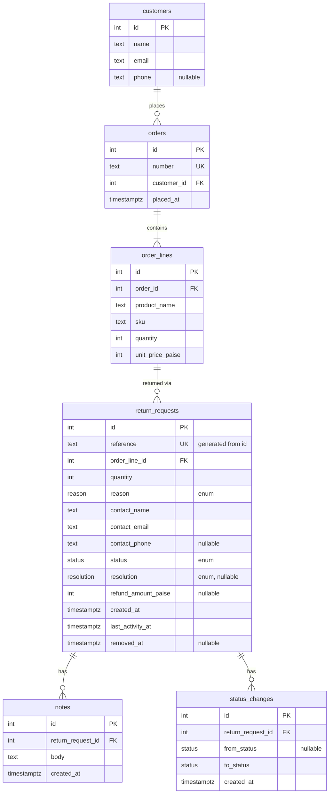

# ReturnDesk

**Live:** https://returndesk-ecru.vercel.app

A returns desk for a small online store. Domain vocabulary is in [`CONTEXT.md`](./CONTEXT.md); key decisions are in [`docs/adr/`](./docs/adr/); architecture and flows are in the [high-level design](./docs/hld.md).

> **Status: in progress.** The feature checklist below is updated as each part lands on the live URL; anything not marked done is not done.

## Feature checklist

| Feature | State |
| --- | --- |
| Skeleton: JSON error envelope, JSON 404 and 405 | done (unknown `/api/*` paths return the JSON 404 on the live URL) |
| Look up an Order | done (`/requests/new` and `GET /api/orders/:number` on the live URL) |
| Raise a Return Request and view it | done (`/requests/new` raises, `/requests/RD-…` shows details and timeline; `POST /api/return-requests`, `GET /api/return-requests/:reference`; duplicate Live request → 409, quantity over ordered → 422) |
| Find a Return Request (search, filter, sort, paging) | not done |
| Status changes and approval | not done |
| Notes | not done |
| Corrections | not done |
| Removal | not done |

## Stack

TypeScript · Next.js (App Router) route handlers · Drizzle over `pg` (node-postgres) · PostgreSQL (Neon, pooled connection string) · Tailwind · deployed on Vercel.

`pg` rather than Neon's HTTP driver because a status change updates the request and inserts a Status Change in one transaction, and the HTTP driver has no interactive transactions.

## Assumptions

- **No authentication.** An Agent is an unauthenticated role; nothing records which agent did what. The brief never mentions login.
- **Agents raise requests for customers.** The customer asks for the return; the agent raises the request on their behalf. There is no customer-facing page.
- **Orders are seeded, read-only data.** ReturnDesk never creates orders, so the seed script creates Customers, Orders and Order Lines as well as Return Requests. See ADR 0001.
- **Open → Rejected is refused.** The brief's diagram only draws Rejected out of In Review, and says only the drawn transitions are legal.
- **Removed requests are never Live**, so removing an Open request frees its Order Line for a new one. See ADR 0002.
- **Money is INR**, stored as integer paise.
- **Quantity** is between 1 and the quantity ordered on the Order Line.
- **Refund Amount** is capped at unit price × units returned.
- **Corrections** (Open / In Review only) may change Contact Details, quantity, Reason, or move to another line on the *same* Order.
- **Reason is locked once Decided**, along with customer and item details. That's stricter than rule 4, which only names customer and item, and it means one lock check instead of two.
- **Contact Details**: name and email required, phone optional. Stored as a snapshot on the request, prefilled from the Customer.
- **No free-text description when raising.** The brief's fixed Reason is the intake field; anything more goes in a Note.

## Design decisions

### Lifecycle

One transition table in code, imported by both the server (enforcement) and the UI (which actions to show):

| From | To | Required input |
| --- | --- | --- |
| (raise) | Open | Order Line, quantity, Reason, Contact Details |
| Open | In Review | none |
| In Review | Approved | Resolution; Refund Amount if and only if Resolution is Refund |
| In Review | Rejected | none; Resolution and Refund Amount must be absent |
| Approved | Completed | none |

Rejected and Completed are final. Removal (separate from status) is allowed from Open or Rejected only.

### Schema

Customers, Orders and Order Lines are the read-only catalogue (ADR 0001). Reason, Status and Resolution are Postgres enums.

### Data

- **Reference** `RD-000123` is a generated column built from the identity `id`: `'RD-' || lpad(id::text, greatest(6, length(id::text)), '0')`, `UNIQUE`. It is race-safe, gaps are harmless, and it never truncates past six digits (plain `lpad(…, 6, …)` would). It is not `COUNT(*)+1` or random.
- **CHECK constraints** hold the state invariants:
  - A request has a resolution exactly when its status is Approved or Completed.
  - A refund amount is present exactly when the resolution is Refund.
  - The refund amount is greater than 0.
  - Quantity is greater than 0.

  Limits that compare against the Order Line (quantity ordered, unit price × units) can't be CHECKs and live in the domain module.
- **Rule 3** (one Live request per Order Line) is a partial unique index on `order_line_id WHERE status IN (open, in_review, approved) AND removed_at IS NULL`. The app doesn't pre-check: an insert that trips the index, matched by its name, becomes a 409 `duplicate_live_request`.
- **Every write carries its own rule in its `WHERE` clause**, so a check and its write can't be split by another agent:
  - Status change: `WHERE id = $1 AND status = $from AND removed_at IS NULL`
  - Approval also pins the values its Refund Amount cap was checked against: `AND quantity = $readQuantity AND order_line_id = $readLine`. A correction landing in between makes it match zero rows instead of silently breaking the cap.
  - Correction: `WHERE id = $1 AND status IN ('open','in_review') AND removed_at IS NULL`
  - Removal: `WHERE id = $1 AND status IN ('open','rejected') AND removed_at IS NULL`

  Zero rows updated means the request is read once more to choose the answer: 404 if it is gone or Removed, 409 if its state moved on.
- **Removal** sets `removed_at`; it is not a status. Every route, reads and writes alike, loads the request through one helper that excludes Removed rows. So `GET`, `PATCH`, notes, status changes and a second `DELETE` on a Removed request all return 404.
- **Notes and Status Changes are append-only.** No update or delete endpoints exist.
- **Last activity** (`last_activity_at`) is set by every write to a request: corrections, status changes and notes. A request someone just commented on rises to the top of "recently active". A note's insert and the bump share one transaction.
- **Status Changes** record `from` (null for the initial Open at raise), `to` and `at`. The detail view shows them interleaved with Notes as one timeline.
- **Seed** inserts rows directly with explicit, spread-out timestamps, so the date sorts and timelines look real. The CHECK constraints and unique index reject invalid seed data. It resets with `TRUNCATE … RESTART IDENTITY CASCADE` and can be re-run.

### API

- `GET /api/return-requests` takes `q` (case-insensitive partial match on Reference, order number, contact name, email), `status` and `reason` (comma-separated multi-select), `sort=createdAt|lastActivityAt`, `order=asc|desc`, and `page`/`pageSize`. It returns the rows plus `total`.
  - Offset paging.
  - `id` is always appended as a sort tiebreaker so pages don't shuffle.
  - All filtering, sorting and paging happens in SQL. `q` has `\ % _` escaped before it goes into `ILIKE '%q%'`.
  - Rows and `total` are two queries run in parallel, which has no empty-page edge case.
  - `pageSize` is at most 100.
- `POST /api/return-requests` raises a request.
- `GET /api/return-requests/:reference` returns the request with its Order Line and Order, plus its timeline (Notes and Status Changes, oldest first).
- `PATCH` / `DELETE /api/return-requests/:reference`: `PATCH` corrects details and refuses `status`; `DELETE` removes (soft).
- `POST /api/return-requests/:reference/status-changes` takes `{ to, resolution?, refundAmountPaise? }`.
- `POST /api/return-requests/:reference/notes`
- `GET /api/orders/:number` returns the Customer and Order Lines, used when raising a request. The number is trimmed and matched case-insensitively.

### Success responses

- A single resource returns `{ "data": … }`.
- The list returns `{ "data": [...], "total", "page", "pageSize" }`.
- Creates (request, note, status change) return 201 with the created resource. `GET` and `PATCH` return 200. `DELETE` returns 204 with no body.

### Errors

Every handler goes through one wrapper that turns validation and domain errors into the envelope below. Request bodies are validated with strict schemas, so unknown fields like `status` on `PATCH` are a 400, not silently ignored. A malformed JSON body is a 400, and a catch-all `app/api/[...path]` returns a JSON 404, so the API never serves Next's HTML error pages.

Every refusal returns `{ "error": { "code": "...", "message": "...", "details"?: ... } }` with an honest status code:

| Status | When |
| --- | --- |
| 400 | Malformed body or query |
| 404 | Unknown or Removed request, unknown order |
| 409 | Illegal transition, duplicate Live request, edit of a Decided request, illegal removal, lost race |
| 422 | Well-formed but breaks a rule: missing Resolution, bad Refund Amount, quantity over ordered, unknown Order Line |

### UI data flow

- The list page is a server component. It reads its state (`q`, filters, sort, page) from the URL and calls the same query function as `GET /api/return-requests`, so there's one query, and links and the back button work.
- Search updates the URL after a 300 ms debounce, not on every keystroke.
- Loading and error states come from `loading.tsx` / `error.tsx`.
- Mutations go through the API, so the server's refusal message reaches the user unchanged.

## Scope and priorities

The brief is deliberately too big. Each step below is a vertical slice through schema, API, UI and `scripts/check-rules.ts`, with its own loading, empty and error states and a 375px check. Each step is committed and pushed separately, checked on the live URL, and updates the README's feature checklist. Tickets are in `.scratch/returndesk-mvp/issues/`.

1. Skeleton deployed to Vercel + Neon, with the JSON error wrapper and 404/405 (hour 1–2, so deployment problems surface early)
2. Look up an Order when raising: catalogue schema and seed, `GET /api/orders/:number`
3. Raise a Return Request and view it: full schema, raise with duplicate and quantity checks, detail page with timeline
4. Find a Return Request: list search, filter, sort and paging in SQL, plus the full seed (30+ requests, Notes, Removed rows). Time-boxed: get a minimal working list first
5. Status Changes and approval: transition table, Resolution and Refund Amount rules, concurrent-approval check
6. Notes, after 5
7. Corrections, after 5: includes the stale-cap race check
8. Removal, after 4 and 5: includes the edit-versus-remove race check
9. Clean-clone check of the README Setup before submission

Steps 6, 7 and 8 can be built in any order once 5 is done.

Cut first if time runs short, or added only if time is left over:
- `pg_trgm` index: plain `ILIKE` scans fine at desk scale.
- DB trigger rejecting `UPDATE`/`DELETE` on notes and status changes: the API already has no route for either.
- Polish beyond the brief's interface rules.

## Not done / next

_To be filled in honestly at submission._

## Setup

_To be written and tested from a clean clone. It must cover:_ copy `.env.example` to `.env` (every variable listed, no real values committed), create the database, run migrations, run the seed, start the app.

## Time spent

| Date | Hours | What |
| --- | --- | --- |
| 19 Oct 2026 | ~1.5 | Skeleton: Next.js, Neon, Vercel, JSON error envelope |
| 19 Oct 2026 | ~1.5 | Look up an Order: catalogue schema, seed, API, raise page, restyle to the new UI |
| 19 Oct 2026 | ~2 | Raise a Return Request and view it: full schema, raise with duplicate and quantity checks, detail page with timeline |
