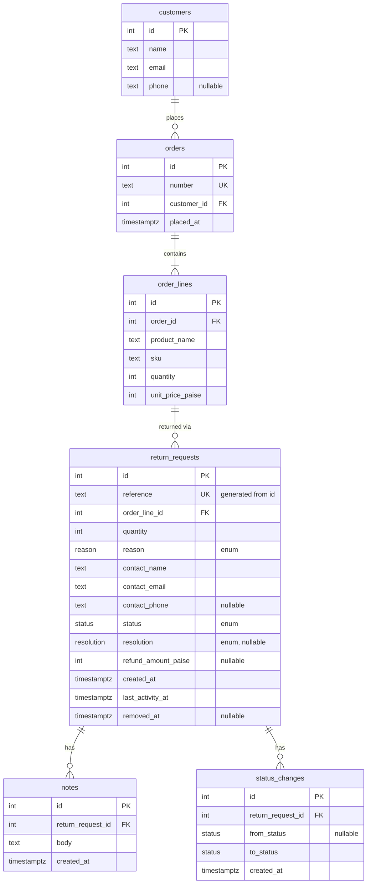

# ReturnDesk

**Live:** https://returndesk-ecru.vercel.app

> **The first load can be slow.** The database is on Neon's free plan, which suspends it after 5 minutes without traffic. The first request after that waits a few seconds while it wakes up; later requests are fast. I chose not to keep it awake with a pinger, because that would use up the free plan's monthly compute.

A returns desk for a small online store: agents raise return requests against seeded orders, move them through review and approval, add notes, correct them and take them off the desk. One Next.js app (pages and JSON API) over Postgres.

**Contents:** [Features](#features) · [Stack](#tech-stack-and-architecture) · [Setup](#local-setup) · [Testing](#testing) · [Data model and rules](#data-model-and-business-rules) · [API](#api-contract-and-error-handling) · [Assumptions](#assumptions-and-design-decisions) · [Limitations](#known-limitations-and-next-steps)

## Features

Everything here works on the live URL: raising a Return Request against a seeded Order (with order lookup and suggestions), searching, filtering, sorting and paging the list on the server, moving a request through its lifecycle with Resolution and Refund Amount rules, adding Notes, correcting a request with stale-write protection, and removing one softly. Loading, empty and error states are handled, and the API answers every failure with a JSON error envelope. The rules behind each are under [Data model and business rules](#data-model-and-business-rules); what's missing is under [Known limitations](#known-limitations-and-next-steps).

## Tech stack and architecture

TypeScript · Next.js (App Router) route handlers · Drizzle over `pg` (node-postgres) · PostgreSQL (Neon, pooled connection string) · Tailwind · deployed on Vercel.

`pg` rather than Neon's HTTP driver because a status change updates the request and inserts a Status Change in one transaction, and the HTTP driver has no interactive transactions.

Dependencies point one way: `app → domain, db`; `db → domain`; `domain` imports nothing. The server enforces every rule; the UI reads the shared transition table only to choose which actions to show.

## Local setup

Needs Node 22+ and Postgres 14+ (a local install, Docker, or a free Neon database). Walked through from a fresh clone on an empty Postgres 16 database with Node 24.

```bash
git clone https://github.com/sahiljadhav7/Frido-ReturnDesk.git && cd Frido-ReturnDesk
npm ci
cp .env.example .env          # then set DATABASE_URL to your database
createdb returndesk            # or: docker run -d -p 5432:5432 -e POSTGRES_PASSWORD=postgres -e POSTGRES_DB=returndesk postgres:16
npm run db:migrate             # creates the tables
npm run seed                   # loads the sample data below; safe to re-run, it resets everything
npm run dev                    # http://localhost:3000
```

### Environment variables

| Variable | Needed by | Notes |
| --- | --- | --- |
| `DATABASE_URL` | the app, `db:migrate`, `seed` | Postgres connection string. Required. On Neon use the pooled string. `.env.example` has a local default. |
| `BASE_URL` | `check-rules` only | Optional. Defaults to `http://localhost:3000`. The script refuses any host except `localhost` or `127.0.0.1`. |

`.env.local` works too and wins over `.env`, as in Next.js. `.env.example` holds no secrets.

### Seed data

`npm run seed` loads 100 customers, 202 orders and 300 return requests (5 of them Removed), with Notes on 161 requests. Every Status and every Reason appears, and every Approved or Completed request has a Resolution. It is deterministic, so every run gives the same data, and it resets the tables first, so it is safe to re-run. Orders ORD-1183 to ORD-1202 have no request, so there is something to raise against.

## Testing

```bash
npm test                       # unit tests for the pure rules and parsers (no database needed)
npm run typecheck              # generates Next's route types, then runs tsc
npm run dev                    # in one terminal
npm run check-rules            # in another: every business rule over HTTP, including the races
```

- Unit tests (Vitest) cover the pure rules: request and query schemas, status-change, correction and removal checks, Order number parsing, `LIKE` escaping, the error wrapper, formatting and URL helpers. They need no database.
- `check-rules` is an integration check. It calls the running API against the real database and exercises transitions, validation, duplicate requests, corrections and removal, printing PASS or FAIL per case and exiting non-zero on a failure.
- It races two approvals, a correction against a refund approval and a correction against a removal (20 rounds each for the last two), and checks that a stale version gets 409. Which side wins varies between runs, so it asserts the invariant: one winner, and the stored Refund Amount never above unit price × stored quantity.
- `check-rules` creates, moves and removes requests, so run it only against a local database. Reseed afterwards for clean demo data.
- These checks are run by hand. They are not part of a CI pipeline.

## Data model and business rules

### Lifecycle

One transition table in code, imported by both the server (enforcement) and the UI (which actions to show):

| From      | To        | Required input                                                |
| --------- | --------- | ------------------------------------------------------------- |
| (raise)   | Open      | Order Line, quantity, Reason, Contact Details                 |
| Open      | In Review | none                                                          |
| In Review | Approved  | Resolution; Refund Amount if and only if Resolution is Refund |
| In Review | Rejected  | none; Resolution and Refund Amount must be absent             |
| Approved  | Completed | none                                                          |

Rejected and Completed are final. Removal (separate from status) is allowed from Open or Rejected only.

### Schema



Customers, Orders and Order Lines are the read-only catalogue. `order_lines` has a unique index on `(order_id, sku)`. Reason, Status and Resolution are Postgres enums.

### Data

- **Reference** `RD-000123` is a generated column built from the identity `id`: `'RD-' || lpad(id::text, greatest(6, length(id::text)), '0')`, `UNIQUE`. It is race-safe, gaps are harmless, and it never truncates past six digits (plain `lpad(…, 6, …)` would). It is not `COUNT(*)+1` or random.
- **CHECK constraints** hold the state invariants:
  - A request has a resolution exactly when its status is Approved or Completed.
  - A refund amount is present exactly when the resolution is Refund.
  - The refund amount is greater than 0.
  - Quantity is greater than 0.

  Limits that compare against the Order Line (quantity ordered, unit price × units) can't be CHECKs and live in the domain module.

- **Rule 3** (one Live request per Order Line) is a partial unique index on `order_line_id WHERE status IN (open, in_review, approved) AND removed_at IS NULL`. The app doesn't pre-check: an insert that trips the index, matched by its name, becomes a 409 `duplicate_live_request`.
- **Every write carries its own rule in its `WHERE` clause**, so a check and its write can't be split by another agent:
  - Status change: `WHERE id = $1 AND status = $from AND removed_at IS NULL`
  - Approval also pins the values its Refund Amount cap was checked against: `AND quantity = $readQuantity AND order_line_id = $readLine`. A correction landing in between makes it match zero rows instead of silently breaking the cap.
  - Correction: `WHERE id = $1 AND status IN ('open','in_review') AND removed_at IS NULL`
  - Removal: `WHERE id = $1 AND status IN ('open','rejected') AND removed_at IS NULL`, plus the version check when the caller sends one

  Zero rows updated means the request is read once more to choose the answer: 404 if it is gone or Removed, 409 if its state moved on.

- **Removal** sets `removed_at`; it is not a status. Every route, reads and writes alike, loads the request through one helper that excludes Removed rows. So `GET`, `PATCH`, notes, status changes and a second `DELETE` on a Removed request all return 404.
- **Notes and Status Changes are append-only.** No update or delete endpoints exist.
- **Last activity** (`last_activity_at`) is set by every write to a request: corrections, status changes and notes. A request someone just commented on rises to the top of "recently active". A note's insert and the bump share one transaction.
- **Status Changes** record `from` (null for the initial Open at raise), `to` and `at`. The detail view shows them interleaved with Notes as one timeline.
- **Seed** inserts rows directly with explicit, spread-out timestamps, so the date sorts and timelines look real. The CHECK constraints and unique index reject invalid seed data. It resets with `TRUNCATE … RESTART IDENTITY CASCADE` and can be re-run.

## API contract and error handling

### API

- `GET /api/return-requests` takes `q` (case-insensitive partial match on Reference, order number, contact name, email), `status` and `reason` (comma-separated multi-select), `sort=createdAt|lastActivityAt`, `order=asc|desc`, and `page`/`pageSize`. It returns the rows plus `total`.
  - Offset paging.
  - `id` is always appended as a sort tiebreaker so pages don't shuffle.
  - All filtering, sorting and paging happens in SQL. `q` has `\ % _` escaped before it goes into `ILIKE '%q%'`.
  - Rows and `total` are two queries run in parallel, which has no empty-page edge case.
  - `pageSize` is at most 100.
- `POST /api/return-requests` raises a request.
- `GET /api/return-requests/:reference` returns the request with its Order Line and Order, plus its timeline (Notes and Status Changes, oldest first).
- `PATCH` / `DELETE /api/return-requests/:reference`: `PATCH` corrects details and refuses `status`; `DELETE` removes (soft).
- `DELETE` returns 204 with no body. It takes an optional `?expectedLastActivityAt=`, the same version a correction takes: if anyone has written to the request since, the removal is refused with 409. The Remove button always sends it.
- `PATCH` takes any of `orderLineId`, `quantity`, `reason`, `contactName`, `contactEmail`, `contactPhone`, plus an optional `expectedLastActivityAt`: the request's `lastActivityAt` as you loaded it. If anyone has written to the request since, the correction is refused with 409 instead of overwriting their change; without it, the later correction wins. The edit form always sends it. `PATCH` returns the corrected request without `orderLine` or `timeline`; `GET` it for those.
- `POST /api/return-requests/:reference/status-changes` takes `{ to, resolution?, refundAmountPaise?, reason? }`. `reason` is required to reject (422 without it) and refused on any other move; it is saved as a Note in the same transaction.
- `POST /api/return-requests/:reference/notes` takes `{ body }` (trimmed, 1–2000 characters) and returns 201 with the Note. Notes are append-only: other methods are a JSON 405.
- `GET /api/orders?q=` returns up to 8 orders for the raise page's live suggestions: digits match the number by prefix, other text matches part of the number or the customer's name or email (wildcards escaped).
- `GET /api/orders/:number` returns the Customer and Order Lines, used when raising a request. The number is trimmed and matched case-insensitively, and loose forms such as `1001`, `ord1001` or `#1001` are read as `ORD-1001`.

### Success responses

- A single resource returns `{ "data": … }`.
- The list returns `{ "data": [...], "total", "page", "pageSize" }`.
- Creates (request, note, status change) return 201 with the created resource. `GET` and `PATCH` return 200. `DELETE` returns 204 with no body.

### Errors

Every handler goes through one wrapper that turns validation and domain errors into the envelope below. Request bodies are validated with strict schemas, so unknown fields like `status` on `PATCH` are a 400, not silently ignored. A malformed JSON body is a 400, and a catch-all `app/api/[...path]` returns a JSON 404, so the API never serves Next's HTML error pages.

Every refusal returns `{ "error": { "code": "...", "message": "...", "details"?: ... } }` with an honest status code:

| Status | When                                                                                                            |
| ------ | --------------------------------------------------------------------------------------------------------------- |
| 400    | Malformed body, query or URL encoding                                                                           |
| 404    | Unknown or Removed request, unknown order                                                                       |
| 409    | Illegal transition, duplicate Live request, edit of a Decided request, illegal removal, lost race               |
| 422    | Well-formed but breaks a rule: missing Resolution, bad Refund Amount, quantity over ordered, unknown Order Line |

### UI data flow

- The list page is a server component. It reads its state (`q`, filters, sort, page) from the URL and calls the same query function as `GET /api/return-requests`, so there's one query, and links and the back button work.
- Search updates the URL after a 300 ms debounce, not on every keystroke.
- Loading states come from `loading.tsx`, except on the list, where results sit in `<Suspense key={query}>` so the skeleton shows on every filter change and the toolbar stays usable. Error states come from `error.tsx`.
- Mutations go through the API, so the server's refusal message reaches the user unchanged.

## Assumptions and design decisions

- **No authentication.** An Agent is an unauthenticated role; nothing records which agent did what. The brief never mentions login.
- **Agents raise requests for customers.** The customer asks for the return; the agent raises the request on their behalf. There is no customer-facing page.
- **Orders are seeded, read-only data.** ReturnDesk never creates orders, so the seed script creates Customers, Orders and Order Lines as well as Return Requests. Every request points at one Order Line, so "one live request per item" is a unique index on a real foreign key rather than a match on typed text, and quantity and refund caps can be checked against the line.
- **An item is an Order Line.** Each product appears at most once per Order (a unique index on `order_id, sku`), so one Live request per Order Line is one per item.
- **Open → Rejected is refused.** The brief's diagram only draws Rejected out of In Review, and says only the drawn transitions are legal.
- **Removed requests are never Live**, so removing an Open request frees its Order Line for a new one. Rule 3 read literally would leave a removed Open request blocking its item forever, since it can no longer be fetched, moved or removed.
- **Money is INR**, stored as integer paise.
- **Quantity** is between 1 and the quantity ordered on the Order Line.
- **Refund Amount** is capped at unit price × units returned.
- **Corrections** (Open / In Review only) may change Contact Details, quantity, Reason, or move to another line on the _same_ Order.
- **Reason is locked once Decided**, along with customer and item details. That's stricter than rule 4, which only names customer and item, and it means one lock check instead of two.
- **Contact Details**: name and email required, phone optional. Stored as a snapshot on the request, prefilled from the Customer.
- **No free-text description when raising.** The brief's fixed Reason is the intake field; anything more goes in a Note.

## Known limitations and next steps

- **No list indexes.** Nothing indexes `status`, `created_at`, `last_activity_at` or `order_lines.order_id`, and search is `ILIKE '%…%'`, which scans. That is fine at 300 requests. At scale I'd add `(last_activity_at, id)` and `(created_at, id)` indexes and a `pg_trgm` index for search.
- Paging is offset-based, so deep pages get slower; keyset paging would fix that.
- The version check on corrections and removals is optional in the API. The UI always sends it, but a client that leaves it out gets last-write-wins, and the comparison is to the millisecond. A write that loses a race also gets a generic 409 `conflict` rather than the specific rule it would now break.
- Nothing in the database ties `removed_at` to a Status. The app only removes Open or Rejected requests, but no CHECK enforces it.
- **No CI.** `check-rules` and the unit tests are run by hand, and migrations are applied by hand before a push.
- There are no agent accounts, so nothing records who changed, removed or noted a request.

Smaller UI rough edges exist too (for example, a validation failure shows one generic message, and the status tabs have no counts).
