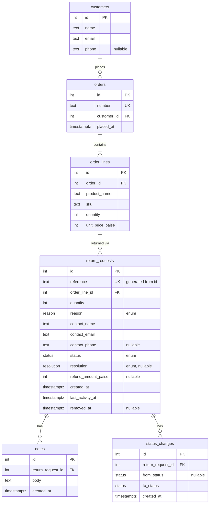

# ReturnDesk

**Live:** https://returndesk-ecru.vercel.app

> **The first load can be slow.** The database is on Neon's free plan, which suspends it after 5 minutes without traffic. The first request after that waits a few seconds while it wakes up; later requests are fast. I chose not to keep it awake with a pinger, because that would use up the free plan's monthly compute.

A returns desk for a small online store: agents raise return requests against seeded orders, move them through review and approval, add notes, correct them and take them off the desk. One Next.js app (pages and JSON API) over Postgres.

> **Status:** every feature in the checklist below works on the live URL. What's missing or rough is under [Not done / next](#not-done--next).

## Feature checklist

| Feature | State |
| --- | --- |
| Skeleton: JSON error envelope, JSON 404 and 405 | done (unknown `/api/*` paths return the JSON 404 on the live URL) |
| Look up an Order | done (`/requests/new` and `GET /api/orders/:number` on the live URL; loose forms like `1001` work, and the field suggests matching orders as you type via `GET /api/orders?q=`) |
| Raise a Return Request and view it | done (`/requests/new` raises, `/requests/RD-…` shows details and timeline; `POST /api/return-requests`, `GET /api/return-requests/:reference`; duplicate Live request → 409, quantity over ordered → 422) |
| Find a Return Request (search, filter, sort, paging) | done (home page and `GET /api/return-requests`: search after a 300 ms pause, Status tabs, Reason multi-select, sort by created or last activity, paging; seeded with 100 customers, 202 orders and 300 requests, 5 of them Removed; ORD-1183 to ORD-1202 have no request yet). The search bar suggests matching requests as you type (from `GET /api/return-requests?q=&pageSize=8`), completes a reference, order number, name or email inline (Tab or → accepts), and opens a request when one is picked. Status tabs show no counts yet, and the header has no "waiting on you · in total" line; there's no `/` shortcut to focus search |
| Status changes and approval | done (detail page shows only the legal moves: Start review, Approve with a Resolution and Refund Amount, Reject, Mark completed; `POST /api/return-requests/:reference/status-changes`; illegal move → 409, missing Resolution or bad Refund Amount → 422, two simultaneous approvals → one 201 and one 409). The lifecycle strip from the UI spec isn't built |
| Notes | done (add-note box under the timeline, on Closed requests too; `POST /api/return-requests/:reference/notes`, no edit or delete route; a Note moves the request up "recently active"). Rejecting asks for a reason, saved as a Note in the same transaction and shown under "Moved to Rejected" |
| Corrections | done (Edit on the detail page while Open or In Review swaps the details card for a form: Contact Details, quantity, Reason, or another line on the same Order; `PATCH /api/return-requests/:reference` with a strict body, so `status` or any unknown field → 400; correcting a Decided request → 409, a line on another Order or over the quantity ordered → 422, a line that already has a Live request → 409). A correction racing a refund approval leaves the stored Refund Amount within unit price × stored quantity: check-rules runs it 20 times; against a local Postgres 2 of 20 rounds went to the approval and 18 to the correction, and the cap held in both. Two agents correcting the same request: the edit form sends the version it loaded, so the second save gets a 409 instead of silently overwriting the first |
| Removal | done (Remove request at the bottom of the actions panel, only while Open or Rejected, asks once inline and returns to the list; `DELETE /api/return-requests/:reference` → 204 with no body; removing In Review, Approved or Completed → 409; after removal `GET`, `PATCH`, Notes, Status Changes and a second `DELETE` → 404, the request leaves the list, the record stays, and its Order Line takes a new request → 201). The page sends the version it loaded, so a removal after someone else's correction, move or Note gets a 409 instead of removing a request the agent hasn't seen. check-rules races a correction against a removal 20 times, both carrying the same version: locally the removal won every round (the correction got 404), so the correction-wins order (removal gets 409) is covered by the stale-version check rather than observed in the race |

## Stack

TypeScript · Next.js (App Router) route handlers · Drizzle over `pg` (node-postgres) · PostgreSQL (Neon, pooled connection string) · Tailwind · deployed on Vercel.

`pg` rather than Neon's HTTP driver because a status change updates the request and inserts a Status Change in one transaction, and the HTTP driver has no interactive transactions.

## Assumptions

- **No authentication.** An Agent is an unauthenticated role; nothing records which agent did what. The brief never mentions login.
- **Agents raise requests for customers.** The customer asks for the return; the agent raises the request on their behalf. There is no customer-facing page.
- **Orders are seeded, read-only data.** ReturnDesk never creates orders, so the seed script creates Customers, Orders and Order Lines as well as Return Requests. Every request points at one Order Line, so "one live request per item" is a unique index on a real foreign key rather than a match on typed text, and quantity and refund caps can be checked against the line.
- **An item is an Order Line.** Each product appears at most once per Order (a unique index on `order_id, sku`), so one Live request per Order Line is one per item.
- **Open → Rejected is refused.** The brief's diagram only draws Rejected out of In Review, and says only the drawn transitions are legal.
- **Removed requests are never Live**, so removing an Open request frees its Order Line for a new one. Rule 3 read literally would leave a removed Open request blocking its item forever, since it can no longer be fetched, moved or removed.
- **Money is INR**, stored as integer paise.
- **Quantity** is between 1 and the quantity ordered on the Order Line.
- **Refund Amount** is capped at unit price × units returned.
- **Corrections** (Open / In Review only) may change Contact Details, quantity, Reason, or move to another line on the *same* Order.
- **Reason is locked once Decided**, along with customer and item details. That's stricter than rule 4, which only names customer and item, and it means one lock check instead of two.
- **Contact Details**: name and email required, phone optional. Stored as a snapshot on the request, prefilled from the Customer.
- **No free-text description when raising.** The brief's fixed Reason is the intake field; anything more goes in a Note.

## Design decisions

### Lifecycle

One transition table in code, imported by both the server (enforcement) and the UI (which actions to show):

| From | To | Required input |
| --- | --- | --- |
| (raise) | Open | Order Line, quantity, Reason, Contact Details |
| Open | In Review | none |
| In Review | Approved | Resolution; Refund Amount if and only if Resolution is Refund |
| In Review | Rejected | none; Resolution and Refund Amount must be absent |
| Approved | Completed | none |

Rejected and Completed are final. Removal (separate from status) is allowed from Open or Rejected only.

### Schema



Customers, Orders and Order Lines are the read-only catalogue. `order_lines` has a unique index on `(order_id, sku)`. Reason, Status and Resolution are Postgres enums.

### Data

- **Reference** `RD-000123` is a generated column built from the identity `id`: `'RD-' || lpad(id::text, greatest(6, length(id::text)), '0')`, `UNIQUE`. It is race-safe, gaps are harmless, and it never truncates past six digits (plain `lpad(…, 6, …)` would). It is not `COUNT(*)+1` or random.
- **CHECK constraints** hold the state invariants:
  - A request has a resolution exactly when its status is Approved or Completed.
  - A refund amount is present exactly when the resolution is Refund.
  - The refund amount is greater than 0.
  - Quantity is greater than 0.

  Limits that compare against the Order Line (quantity ordered, unit price × units) can't be CHECKs and live in the domain module.
- **Rule 3** (one Live request per Order Line) is a partial unique index on `order_line_id WHERE status IN (open, in_review, approved) AND removed_at IS NULL`. The app doesn't pre-check: an insert that trips the index, matched by its name, becomes a 409 `duplicate_live_request`.
- **Every write carries its own rule in its `WHERE` clause**, so a check and its write can't be split by another agent:
  - Status change: `WHERE id = $1 AND status = $from AND removed_at IS NULL`
  - Approval also pins the values its Refund Amount cap was checked against: `AND quantity = $readQuantity AND order_line_id = $readLine`. A correction landing in between makes it match zero rows instead of silently breaking the cap.
  - Correction: `WHERE id = $1 AND status IN ('open','in_review') AND removed_at IS NULL`
  - Removal: `WHERE id = $1 AND status IN ('open','rejected') AND removed_at IS NULL`, plus the version check when the caller sends one

  Zero rows updated means the request is read once more to choose the answer: 404 if it is gone or Removed, 409 if its state moved on.
- **Removal** sets `removed_at`; it is not a status. Every route, reads and writes alike, loads the request through one helper that excludes Removed rows. So `GET`, `PATCH`, notes, status changes and a second `DELETE` on a Removed request all return 404.
- **Notes and Status Changes are append-only.** No update or delete endpoints exist.
- **Last activity** (`last_activity_at`) is set by every write to a request: corrections, status changes and notes. A request someone just commented on rises to the top of "recently active". A note's insert and the bump share one transaction.
- **Status Changes** record `from` (null for the initial Open at raise), `to` and `at`. The detail view shows them interleaved with Notes as one timeline.
- **Seed** inserts rows directly with explicit, spread-out timestamps, so the date sorts and timelines look real. The CHECK constraints and unique index reject invalid seed data. It resets with `TRUNCATE … RESTART IDENTITY CASCADE` and can be re-run.

### API

- `GET /api/return-requests` takes `q` (case-insensitive partial match on Reference, order number, contact name, email), `status` and `reason` (comma-separated multi-select), `sort=createdAt|lastActivityAt`, `order=asc|desc`, and `page`/`pageSize`. It returns the rows plus `total`.
  - Offset paging.
  - `id` is always appended as a sort tiebreaker so pages don't shuffle.
  - All filtering, sorting and paging happens in SQL. `q` has `\ % _` escaped before it goes into `ILIKE '%q%'`.
  - Rows and `total` are two queries run in parallel, which has no empty-page edge case.
  - `pageSize` is at most 100.
- `POST /api/return-requests` raises a request.
- `GET /api/return-requests/:reference` returns the request with its Order Line and Order, plus its timeline (Notes and Status Changes, oldest first).
- `PATCH` / `DELETE /api/return-requests/:reference`: `PATCH` corrects details and refuses `status`; `DELETE` removes (soft).
- `DELETE` returns 204 with no body. It takes an optional `?expectedLastActivityAt=`, the same version a correction takes: if anyone has written to the request since, the removal is refused with 409. The Remove button always sends it.
- `PATCH` takes any of `orderLineId`, `quantity`, `reason`, `contactName`, `contactEmail`, `contactPhone`, plus an optional `expectedLastActivityAt`: the request's `lastActivityAt` as you loaded it. If anyone has written to the request since, the correction is refused with 409 instead of overwriting their change; without it, the later correction wins. The edit form always sends it. `PATCH` returns the corrected request without `orderLine` or `timeline`; `GET` it for those.
- `POST /api/return-requests/:reference/status-changes` takes `{ to, resolution?, refundAmountPaise?, reason? }`. `reason` is required to reject (422 without it) and refused on any other move; it is saved as a Note in the same transaction.
- `POST /api/return-requests/:reference/notes` takes `{ body }` (trimmed, 1–2000 characters) and returns 201 with the Note. Notes are append-only: other methods are a JSON 405.
- `GET /api/orders?q=` returns up to 8 orders for the raise page's live suggestions: digits match the number by prefix, other text matches part of the number or the customer's name or email (wildcards escaped).
- `GET /api/orders/:number` returns the Customer and Order Lines, used when raising a request. The number is trimmed and matched case-insensitively, and loose forms such as `1001`, `ord1001` or `#1001` are read as `ORD-1001`.

### Success responses

- A single resource returns `{ "data": … }`.
- The list returns `{ "data": [...], "total", "page", "pageSize" }`.
- Creates (request, note, status change) return 201 with the created resource. `GET` and `PATCH` return 200. `DELETE` returns 204 with no body.

### Errors

Every handler goes through one wrapper that turns validation and domain errors into the envelope below. Request bodies are validated with strict schemas, so unknown fields like `status` on `PATCH` are a 400, not silently ignored. A malformed JSON body is a 400, and a catch-all `app/api/[...path]` returns a JSON 404, so the API never serves Next's HTML error pages.

Every refusal returns `{ "error": { "code": "...", "message": "...", "details"?: ... } }` with an honest status code:

| Status | When |
| --- | --- |
| 400 | Malformed body, query or URL encoding |
| 404 | Unknown or Removed request, unknown order |
| 409 | Illegal transition, duplicate Live request, edit of a Decided request, illegal removal, lost race |
| 422 | Well-formed but breaks a rule: missing Resolution, bad Refund Amount, quantity over ordered, unknown Order Line |

### UI data flow

- The list page is a server component. It reads its state (`q`, filters, sort, page) from the URL and calls the same query function as `GET /api/return-requests`, so there's one query, and links and the back button work.
- Search updates the URL after a 300 ms debounce, not on every keystroke.
- Loading states come from `loading.tsx`, except on the list, where results sit in `<Suspense key={query}>` so the skeleton shows on every filter change and the toolbar stays usable. Error states come from `error.tsx`.
- Mutations go through the API, so the server's refusal message reaches the user unchanged.

## Scope and priorities

The brief is deliberately too big. Each step below is a vertical slice through schema, API, UI and `scripts/check-rules.ts`, with its own loading, empty and error states and a 375px check. Each step is committed and pushed separately, checked on the live URL, and updates the README's feature checklist.

1. Skeleton deployed to Vercel + Neon, with the JSON error wrapper and 404/405 (hour 1–2, so deployment problems surface early)
2. Look up an Order when raising: catalogue schema and seed, `GET /api/orders/:number`
3. Raise a Return Request and view it: full schema, raise with duplicate and quantity checks, detail page with timeline
4. Find a Return Request: list search, filter, sort and paging in SQL, plus the full seed (30+ requests, Notes, Removed rows). Time-boxed: get a minimal working list first
5. Status Changes and approval: transition table, Resolution and Refund Amount rules, concurrent-approval check
6. Notes, after 5
7. Corrections, after 5: includes the stale-cap race check
8. Removal, after 4 and 5: includes the edit-versus-remove race check
9. Clean-clone check of the README Setup before submission

Steps 6, 7 and 8 can be built in any order once 5 is done.

Cut first if time runs short, or added only if time is left over:
- `pg_trgm` index: plain `ILIKE` scans fine at desk scale.
- DB trigger rejecting `UPDATE`/`DELETE` on notes and status changes: the API already has no route for either.
- Polish beyond the brief's interface rules.

## Not done / next

- **No list indexes.** Nothing indexes `status`, `created_at`, `last_activity_at` or `order_lines.order_id`, and search is `ILIKE '%…%'`, which scans. Fine at 300 requests; at scale I'd add `(last_activity_at, id)` and `(created_at, id)` indexes and a `pg_trgm` index for search.
- **Offset paging.** Deep pages get slower; keyset paging would fix it.
- **A 400 shows one generic message.** The server returns which fields failed in `details`, but the UI shows only "Request does not match the expected shape", e.g. for an email like `a@b` that the browser accepts and the server refuses.
- **The actions panel doesn't refresh itself after a 409.** It shows the refusal; the agent reloads to see what changed.
- **Status tabs have no counts**, and there's no "waiting on you" summary or `/` shortcut from the UI spec.
- **Lost races answer a generic `conflict`.** A write that loses to another agent gets 409 `conflict`, not the specific rule it would now break.
- **The version check is optional in the API.** The UI always sends it; an API client that leaves it out gets last-write-wins. It compares timestamps to the millisecond.
- **Nothing in the database ties `removed_at` to a Status.** The app only removes Open or Rejected requests, but no CHECK enforces it.
- **No agent accounts**, so nothing records who changed, removed or noted a request.
- **`check-rules` is a script, not CI.** It runs against a local server and database by hand; unit tests cover the pure rules only.

## Setup

Needs Node 22+ and Postgres 14+ (a local install, Docker, or a free Neon database).

```bash
git clone https://github.com/sahiljadhav7/Frido-ReturnDesk.git && cd Frido-ReturnDesk
npm ci
cp .env.example .env          # then set DATABASE_URL to your database
createdb returndesk            # or: docker run -d -p 5432:5432 -e POSTGRES_PASSWORD=postgres -e POSTGRES_DB=returndesk postgres:16
npm run db:migrate             # creates the tables
npm run seed                   # 100 customers, 202 orders, 300 return requests; safe to re-run, it resets everything
npm run dev                    # http://localhost:3000
```

`.env.local` works too and wins over `.env`, as in Next.js.

Checks:

```bash
npm test                       # unit tests for the rules and parsers
npm run typecheck
npm run check-rules            # with `npm run dev` running: every business rule over HTTP, including the races
```

`check-rules` only runs against `localhost`: it creates, moves and removes requests. Reseed afterwards for clean demo data.

## Time spent

| Date | Hours | What |
| --- | --- | --- |
| 19 Oct 2026 | ~1.5 | Skeleton: Next.js, Neon, Vercel, JSON error envelope |
| 19 Oct 2026 | ~1.5 | Look up an Order: catalogue schema, seed, API, raise page, restyle to the new UI |
| 19 Oct 2026 | ~2 | Raise a Return Request and view it: full schema, raise with duplicate and quantity checks, detail page with timeline |
| 19 Oct 2026 | ~2 | Find a Return Request: list query in SQL, list page with search, filters, sort and paging, full seed |
| 19 Oct 2026 | ~1.5 | Status changes and approval: transition table, approval rules, guarded write, actions panel, concurrency check |
| 20 Oct 2026 | ~1 | Notes: add-note write and form, rejection reason saved as a Note, outcome labels in the timeline |
| 20 Oct 2026 | ~1.5 | Corrections: guarded correction write, edit form sharing the raise fields, stale-cap race check |
| 20 Oct 2026 | ~1 | Removal: guarded soft delete with an optional version, Remove with an inline confirm, edit-versus-remove race check |
| 20 Oct 2026 | ~1.5 | Review fixes: JSON 400 for bad URL encoding, one item per order, path checks before querying, Setup tested from a clean clone |
