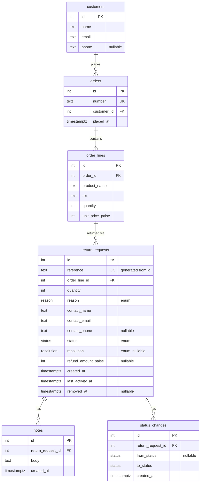

# ReturnDesk

<p align="center">
  A returns desk for a small online store. Agents raise return requests, review and decide them, add notes, correct them and take them off the desk.
</p>
<p align="center">
  <b>Live: <a href="https://returndesk-ecru.vercel.app">https://returndesk-ecru.vercel.app</a></b>
</p>
<p align="center">
  <a href="#about-the-project">About</a> •
  <a href="#features">Features</a> •
  <a href="#getting-started">Getting started</a> •
  <a href="#how-it-works">How it works</a> •
  <a href="#decisions-and-problems">Decisions</a> •
  <a href="#assumptions">Assumptions</a> •
  <a href="#known-limits">Known limits</a> •
  <a href="#time-spent">Time spent</a>
</p>

## About the project

An agent picks an Order and raises a Return Request for one item on it. The request then moves through a fixed lifecycle: Open, In Review, then Approved or Rejected, and Approved requests end as Completed. Notes can be added at any point, and the whole history shows as one timeline.

It is one Next.js app, with pages and a JSON API, over Postgres. The server enforces every business rule. The UI only reads the shared transition table to decide which buttons to show.

## Features

- Raise a request against a seeded Order. The form looks the order up as you type and generates the Reference (`RD-000123`) itself.
- Only one Live request per item. A unique index in the database enforces it.
- Search by Reference, order number, customer name or email, filter by Status and Reason, sort and page. All of it runs in SQL, and search waits after typing before it fires (200 ms for the suggestions, 300 ms for the list).
- Only legal status moves. Approving needs a Resolution (Refund, Replacement or Store Credit), and a Refund Amount only for refunds.
- Notes and Status Changes are append-only and show together as one timeline.
- Open and In Review requests can be corrected. If someone else changed the request since you loaded it, the save is refused instead of overwriting them.
- Open or Rejected requests can be removed. The record stays in the database, but the request leaves the list and answers 404 everywhere.
- The UI offers only the actions that are legal for the request's current state, and shows the server's reason when it refuses one.
- Loading, empty and error states on the list and detail pages, and a server refusal shown on every form.
- Every API failure returns one JSON error shape with a fitting status code, including unknown paths.

## Getting started

You need Node 22 or newer and Postgres 14 or newer (a local install, Docker or a free Neon database). I ran these steps from a fresh clone against an empty Postgres 16 database, with Node 24.

```bash
git clone https://github.com/sahiljadhav7/Frido-ReturnDesk.git && cd Frido-ReturnDesk
npm ci
cp .env.example .env          # then set DATABASE_URL to your database
createdb returndesk            # or: docker run -d -p 5432:5432 -e POSTGRES_PASSWORD=postgres -e POSTGRES_DB=returndesk postgres:16
npm run db:migrate             # creates the tables
npm run seed                   # loads the sample data; safe to re-run, it resets everything
npm run dev                    # http://localhost:3000
```

`.env` needs one variable, `DATABASE_URL`, a Postgres connection string (on Neon, use the pooled one). `.env.local` also works and wins over `.env`. `check-rules` reads an optional `BASE_URL` (default `http://localhost:3000`) and refuses any host except localhost.

### Seed data

The seed is deterministic, so every run gives the same data. It creates 100 customers, 202 orders and 300 return requests (5 of them Removed), with Notes on 161. Every Status and every Reason appears, and every Approved or Completed request has a Resolution. Orders ORD-1183 to ORD-1202 have no request, so there is something to raise against.

### Tests

```bash
npm test                       # unit tests, plus the five business rules against your local database
npm run typecheck              # generates Next's route types, then runs tsc
npm run dev                    # in one terminal
npm run check-rules            # in another: the same rules over HTTP, plus the races and the list
```

`npm test` runs the unit tests for the pure rules and parsers, then the five business rules through the real route handlers and Postgres (`src/app/api/rules.test.ts`). The rule tests make their own order and lines and delete them afterwards. They run only when `DATABASE_URL` points at localhost, and are skipped otherwise, so the tests never touch a hosted database. Run `npm run db:migrate` first; the seed isn't needed.

`check-rules` calls the running API against the real database and prints PASS or FAIL per case. It covers transitions, validation, duplicates, corrections and removal, and races approvals, corrections and removals against each other. Which side wins a race varies, so it asserts what must always hold: one winner, and a Refund Amount never above unit price × quantity.

It creates and removes requests, so run it only against a local database and reseed afterwards. I run it by hand. There is no CI.

## How it works

| Part | Built with |
|---|---|
| App | Next.js (App Router), React, route handlers |
| Database | PostgreSQL on Neon, Drizzle over `pg` |
| Validation | zod, strict schemas |
| Styling | Tailwind |
| Hosting | Vercel |

I use `pg` rather than Neon's HTTP driver because a status change needs a real transaction (update the request, insert a Status Change), which the HTTP driver can't do.

Dependencies point one way: `app → domain, db`, `db → domain`, and `domain` imports nothing. The list page is a server component that reads its search, filters, sort and page from the URL and calls the same query function as the API. Mutations go through the API, so the server's refusal message reaches the user as written.

### Lifecycle

| From      | To        | Required input                                                |
| --------- | --------- | ------------------------------------------------------------- |
| (raise)   | Open      | Order Line, quantity, Reason, Contact Details                 |
| Open      | In Review | none                                                          |
| In Review | Approved  | Resolution; Refund Amount if and only if Resolution is Refund |
| In Review | Rejected  | none; Resolution and Refund Amount must be absent             |
| Approved  | Completed | none                                                          |

Rejected and Completed are final. Removal is separate from status and allowed only from Open or Rejected.

### Schema



Customers, Orders and Order Lines are the read-only catalogue. Reason, Status and Resolution are Postgres enums. CHECK constraints hold the state rules: a resolution exists exactly when the status is Approved or Completed, a refund amount exists exactly when the resolution is Refund (and is above 0), quantity is above 0, and a request can only be Removed while it is Open or Rejected. Limits that depend on the Order Line can't be CHECKs, so they live in the domain module.

### API

- `GET /api/return-requests` takes `q`, `status` and `reason` (comma-separated), `sort=createdAt|lastActivityAt`, `order=asc|desc`, `page` and `pageSize` (max 100). It returns the rows plus `total`. `q` matches Reference, order number, contact name or email, and is escaped before it reaches `ILIKE`.
- `POST /api/return-requests` raises a request.
- `GET /api/return-requests/:reference` returns the request with its Order Line, Order and timeline.
- `PATCH /api/return-requests/:reference` corrects the item, quantity, Reason or contact fields. It refuses `status`.
- `DELETE /api/return-requests/:reference` removes the request and returns 204.
- `PATCH` and `DELETE` accept an optional `expectedLastActivityAt`. If anyone has written since, the call gets a 409. The UI always sends it. Without it, the last write wins.
- `POST …/status-changes` takes `{ to, resolution?, refundAmountPaise?, reason? }`. `reason` is optional and only allowed when rejecting. When given, it is saved as a Note.
- `POST …/notes` takes `{ body }` (1 to 2000 characters) and returns 201.
- `GET /api/orders?q=` returns up to 8 matches for the raise page. `GET /api/orders/:number` returns the Customer and Order Lines, and reads `1001` or `#1001` as `ORD-1001`.

Single resources come back as `{ "data": … }` and the list as `{ "data": [...], "total", "page", "pageSize" }`. Creates return 201, reads and corrections 200.

### Errors

Every handler goes through one wrapper that returns `{ "error": { "code", "message", "details"? } }`. Bodies use strict schemas, so an unknown field like `status` on `PATCH` is a 400. A validation failure names the fields, for example `Invalid request. contactEmail: Invalid email address`, and the UI shows that message as written. A catch-all route returns a JSON 404, so the API never serves an HTML error page.

| Status | When |
| --- | --- |
| 400 | Malformed body, query or URL encoding |
| 404 | Unknown or Removed request, unknown order |
| 409 | Illegal transition, duplicate Live request, edit of a Decided request, illegal removal, lost race |
| 422 | Well-formed but breaks a rule: missing Resolution, bad Refund Amount, quantity over ordered, unknown Order Line |

## Decisions and problems

### Rules live in the database and in the WHERE clause

Checking a rule and then writing is a race: another agent can change the request in between. So each write repeats its rule in its own `WHERE` clause (for example a status change is `WHERE id = $1 AND status = $from AND removed_at IS NULL`). If zero rows update, I read the request once more and answer 404 if it is gone or Removed, or 409 if its state moved on.

Approval has a second hazard. The Refund Amount cap depends on the quantity and Order Line, and a correction can change both after I checked. So approval also pins `quantity` and `order_line_id` in its `WHERE`, and a racing correction makes it match zero rows instead of breaking the cap. `check-rules` runs that race 20 times.

Rule 3, one Live request per item, is a partial unique index on `order_line_id` for Live, non-removed requests. The app doesn't pre-check it. A clash becomes a 409 `duplicate_live_request`.

### Removal is a timestamp, not a status

Status says where a request is in its life. Removal says whether the desk still shows it. Making Removed a sixth status would need a transition rule into and out of it from every other status, and would overwrite the status the request had. So removal sets `removed_at`. Every route loads requests through one helper that excludes Removed rows, so any call on a Removed request returns 404.

### Two agents editing the same request

Corrections and removals take an optional `expectedLastActivityAt`, the timestamp the agent loaded. Every write bumps `last_activity_at`, so if anyone wrote in between, the second call gets a 409 instead of overwriting them. It is optional in the API, so a client that leaves it out gets last-write-wins. The UI always sends it. Adding a Note or moving the status also bumps the timestamp, so while the Edit form is open the UI sends the latest one, unless someone changed the details themselves since Edit opened. Only then is the save refused.

### Indexes, and an index Postgres ignored

The list sorts by `last_activity_at` or `created_at`, with `id` as tiebreaker, and always filters out Removed rows. Each sort has a partial index on `removed_at IS NULL`. On a scratch copy with about 234,000 requests, the first page dropped from 56 ms to 0.4 ms.

The first version of those indexes did nothing. drizzle-kit generated them as `DESC NULLS LAST`, and Postgres' default for a descending sort is `NULLS FIRST`, so the planner ignored them and kept sorting. I found it by reading the query plan, and declared the indexes `NULLS FIRST`.

Search is still a scanning `ILIKE '%…%'`. I tried a per-column trigram rewrite. It cut a rare search from about 165 ms to about 6 ms, but made common searches as slow as 400 ms, because it gathers every match before sorting. The simple query stops after the first 20 matches, so I kept it.

## Assumptions

- There is no auth and no customer page. Agents raise requests on a customer's behalf, and nothing records who did what.
- Orders are seeded, read-only data. An item is an Order Line, so "one live request per item" is a unique index on a real foreign key.
- Open to Rejected is refused, because the brief only draws Rejected out of In Review.
- Rejecting takes an optional reason, saved as a Note. The brief doesn't ask for one, so the API doesn't require it. The reject form in the UI offers the field.
- Removed requests are never Live. Otherwise a removed Open request would block its item forever.
- Money is INR in integer paise. Quantity is 1 up to the quantity ordered, and a Refund Amount is capped at unit price × units returned.
- Corrections can change contact details, quantity, Reason, or the line within the same Order. Reason is locked once a request is Decided, which is stricter than rule 4 but needs one lock check instead of two.
- Contact details are a snapshot on the request (name and email required, phone optional). There is no free-text description, so anything extra goes in a Note.

## Known limits

- Search and totals are unindexed. Search is a scanning `ILIKE` and `count(*)` reads every match. It is fine at 300 requests and slow only on a table hundreds of times larger.
- Paging is offset-based, so deep pages get slower. Keyset paging would fix that.
- A lost race gets the same 409 `conflict` code whatever rule it lost to. The message says the request changed and to reload, but the code doesn't say which rule.
- No CI. Tests and `check-rules` run by hand, and so do migrations. Run `npm run db:migrate` against production before pushing a schema change.
- No agent accounts, and no counts on the status tabs.
- A request page that doesn't exist shows a not-found message but answers HTTP 200, because the page streams. The raise page has no loading skeleton.

## Time spent

About 14 hours, covering design, implementation, testing, deployment and this README.
