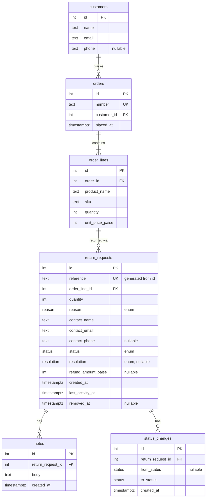

# ReturnDesk

**Live:** https://returndesk-ecru.vercel.app

A returns desk for a small online store: agents raise return requests against seeded orders, move them through review and approval, add notes, correct them and take them off the desk. One Next.js app (pages and JSON API) over Postgres.

**Contents:** [Features](#features) · [Stack](#tech-stack-and-architecture) · [Setup](#local-setup) · [Testing](#testing) · [Data model and rules](#data-model-and-business-rules) · [API](#api-contract-and-error-handling) · [Assumptions](#assumptions-and-design-decisions) · [Limitations](#known-limitations-and-next-steps)

## Features

All of this works on the live URL:

- **Raise a Return Request** against a seeded Order, with order lookup and live suggestions, a generated Reference, and a quantity check against the Order Line.
- **One Live request per item**, enforced by a partial unique index rather than an app-side check.
- **Find requests** by Reference, order number, customer name or email, with Status and Reason filters, two sorts and paging, all done in SQL.
- **Lifecycle with real rules:** only legal moves, a Resolution on approval, and a Refund Amount that is required for a refund and capped at unit price × units returned.
- **Append-only Notes and Status Changes**, shown as one timeline on the detail page. Rejecting asks for a reason and saves it as a Note.
- **Corrections** while a request is Open or In Review, with stale-write protection so a second agent's edit is never silently overwritten.
- **Soft removal** of Open or Rejected requests. The record stays, the Order Line is freed, and the request answers 404 everywhere.
- **Concurrency-safe writes:** each write repeats its rule in its `WHERE` clause, and `check-rules` races the risky pairs.
- **Consistent API errors:** one JSON envelope and honest status codes, including for unknown paths.
- **Loading, empty and error states** on every page.

The rules behind each are under [Data model and business rules](#data-model-and-business-rules); what's missing is under [Known limitations](#known-limitations-and-next-steps).

## Tech stack and architecture

TypeScript · Next.js (App Router) route handlers · Drizzle over `pg` (node-postgres) · PostgreSQL (Neon, pooled connection string) · Tailwind · deployed on Vercel.

`pg` rather than Neon's HTTP driver because a status change updates the request and inserts a Status Change in one transaction, and the HTTP driver has no interactive transactions.

Dependencies point one way: `app → domain, db`; `db → domain`; `domain` imports nothing. The server enforces every rule; the UI reads the shared transition table only to choose which actions to show.

## Local setup

Needs Node 22+ and Postgres 14+ (a local install, Docker, or a free Neon database). Walked through from a fresh clone on an empty Postgres 16 database with Node 24.

```bash
git clone https://github.com/sahiljadhav7/Frido-ReturnDesk.git && cd Frido-ReturnDesk
npm ci
cp .env.example .env          # then set DATABASE_URL to your database
createdb returndesk            # or: docker run -d -p 5432:5432 -e POSTGRES_PASSWORD=postgres -e POSTGRES_DB=returndesk postgres:16
npm run db:migrate             # creates the tables
npm run seed                   # loads the sample data below; safe to re-run, it resets everything
npm run dev                    # http://localhost:3000
```

### Environment variables

| Variable | Needed by | Notes |
| --- | --- | --- |
| `DATABASE_URL` | the app, `db:migrate`, `seed` | Postgres connection string. Required. On Neon use the pooled string. `.env.example` has a local default. |
| `BASE_URL` | `check-rules` only | Optional. Defaults to `http://localhost:3000`. The script refuses any host except `localhost` or `127.0.0.1`. |

`.env.local` works too and wins over `.env`, as in Next.js. `.env.example` holds no secrets.

### Seed data

`npm run seed` loads 100 customers, 202 orders and 300 return requests (5 of them Removed), with Notes on 161 requests. Every Status and every Reason appears, and every Approved or Completed request has a Resolution. It is deterministic, so every run gives the same data, and it resets the tables first, so it is safe to re-run. Orders ORD-1183 to ORD-1202 have no request, so there is something to raise against.

## Testing

```bash
npm test                       # unit tests for the pure rules and parsers (no database needed)
npm run typecheck              # generates Next's route types, then runs tsc
npm run dev                    # in one terminal
npm run check-rules            # in another: every business rule over HTTP, including the races
```

- Unit tests (Vitest) cover the pure rules: request and query schemas, status-change, correction and removal checks, Order number parsing, `LIKE` escaping, the error wrapper, formatting and URL helpers. They need no database.
- `check-rules` is an integration check. It calls the running API against the real database and exercises transitions, validation, duplicate requests, corrections and removal, printing PASS or FAIL per case and exiting non-zero on a failure.
- It races two approvals, a correction against a refund approval and a correction against a removal (20 rounds each for the last two), and checks that a stale version gets 409. Which side wins varies between runs, so it asserts the invariant: one winner, and the stored Refund Amount never above unit price × stored quantity.
- `check-rules` creates, moves and removes requests, so run it only against a local database. Reseed afterwards for clean demo data.
- These checks are run by hand. They are not part of a CI pipeline.

## Data model and business rules

### Lifecycle

One transition table in code, imported by both the server (enforcement) and the UI (which actions to show):

| From      | To        | Required input                                                |
| --------- | --------- | ------------------------------------------------------------- |
| (raise)   | Open      | Order Line, quantity, Reason, Contact Details                 |
| Open      | In Review | none                                                          |
| In Review | Approved  | Resolution; Refund Amount if and only if Resolution is Refund |
| In Review | Rejected  | none; Resolution and Refund Amount must be absent             |
| Approved  | Completed | none                                                          |

Rejected and Completed are final. Removal (separate from status) is allowed from Open or Rejected only.

### Schema



Customers, Orders and Order Lines are the read-only catalogue. `order_lines` has a unique index on `(order_id, sku)`. Reason, Status and Resolution are Postgres enums.

### Data

**Reference.** `RD-000123` is a generated, `UNIQUE` column built from the identity `id`: `'RD-' || lpad(id::text, greatest(6, length(id::text)), '0')`. It is race-safe, and the `greatest` stops it truncating past six digits.

**Constraints.** CHECKs hold the state invariants: a resolution exists exactly when the status is Approved or Completed, a refund amount exists exactly when the resolution is Refund and must be above 0, and quantity is above 0. Limits that depend on the Order Line (quantity ordered, unit price × units) can't be CHECKs, so they live in the domain module.

**Rule 3** is a partial unique index on `order_line_id WHERE status IN (open, in_review, approved) AND removed_at IS NULL`. The app doesn't pre-check. An insert that trips the index becomes a 409 `duplicate_live_request`.

**Writes.** Each write carries its rule in its `WHERE` clause, so a check and its write can't be split by another agent:

- Status change: `WHERE id = $1 AND status = $from AND removed_at IS NULL`. Approval also pins `quantity` and `order_line_id` to the values the refund cap was checked against, so a concurrent correction makes it match zero rows instead of breaking the cap.
- Correction: `... AND status IN ('open','in_review') AND removed_at IS NULL`
- Removal: `... AND status IN ('open','rejected') AND removed_at IS NULL`, plus the version check when the caller sends one.

If zero rows update, the request is read once more to choose the answer: 404 if it is gone or Removed, 409 if its state moved on.

**Removal** sets `removed_at`; it is not a status. Every route loads requests through one helper that excludes Removed rows, so any method on a Removed request returns 404.

**Indexes.** The list's two sorts each have a partial index on `removed_at IS NULL`, stored descending with `id` as the tiebreaker: `(last_activity_at, id)` and `(created_at, id)`. Ascending order reads the same index backwards. They are declared `NULLS FIRST`, which is Postgres' default for descending order; a `NULLS LAST` index is ignored by the planner because the query doesn't ask for it.

**History.** Notes and Status Changes are append-only, with no update or delete endpoints. Every write bumps `last_activity_at` (for notes, in the same transaction). A Status Change records `from` (null for the initial Open), `to` and the time, and the detail view interleaves them with Notes as one timeline.

## API contract and error handling

### API

- `GET /api/return-requests` takes `q` (case-insensitive partial match on Reference, order number, contact name or email), `status` and `reason` (comma-separated), `sort=createdAt|lastActivityAt`, `order=asc|desc`, and `page`/`pageSize` (max 100). It returns the rows plus `total`. Filtering, sorting and paging all happen in SQL, with `id` as a tiebreaker so pages don't shuffle. `q` has `\ % _` escaped before it goes into `ILIKE`.
- `POST /api/return-requests` raises a request.
- `GET /api/return-requests/:reference` returns the request with its Order Line, Order and timeline (Notes and Status Changes, oldest first).
- `PATCH /api/return-requests/:reference` corrects `orderLineId`, `quantity`, `reason` or the contact fields. It refuses `status`.
- `DELETE /api/return-requests/:reference` soft-removes and returns 204.
- `PATCH` and `DELETE` both accept an optional `expectedLastActivityAt`, the `lastActivityAt` you loaded. If anyone has written since, the call gets a 409 instead of overwriting their change. The UI always sends it; without it, the last write wins.
- `POST .../status-changes` takes `{ to, resolution?, refundAmountPaise?, reason? }`. `reason` is required to reject (422 without it), refused on any other move, and saved as a Note in the same transaction.
- `POST .../notes` takes `{ body }` (1–2000 characters, trimmed) and returns 201. Other methods are a JSON 405.
- `GET /api/orders?q=` returns up to 8 matches for the raise page's suggestions. `GET /api/orders/:number` returns the Customer and Order Lines, and reads loose forms like `1001` or `#1001` as `ORD-1001`.

Responses are `{ "data": … }` for one resource and `{ "data": [...], "total", "page", "pageSize" }` for the list. Creates return 201, `GET` and `PATCH` return 200.

### Errors

Every handler goes through one wrapper that turns validation and domain errors into `{ "error": { "code", "message", "details"? } }`. Bodies use strict schemas, so an unknown field like `status` on `PATCH` is a 400. A catch-all `app/api/[...path]` returns a JSON 404, so the API never serves Next's HTML error pages.

| Status | When |
| --- | --- |
| 400 | Malformed body, query or URL encoding |
| 404 | Unknown or Removed request, unknown order |
| 409 | Illegal transition, duplicate Live request, edit of a Decided request, illegal removal, lost race |
| 422 | Well-formed but breaks a rule: missing Resolution, bad Refund Amount, quantity over ordered, unknown Order Line |

### UI data flow

The list page is a server component. It reads `q`, filters, sort and page from the URL and calls the same query function as the API, so links and the back button work. Search updates the URL after a 300 ms debounce. Loading states come from `loading.tsx` (on the list, a `<Suspense key={query}>` shows the skeleton on every filter change), and errors from `error.tsx`. Mutations go through the API, so the server's refusal message reaches the user unchanged.

## Assumptions and design decisions

- **No auth, no customer page.** An Agent is an unauthenticated role, and agents raise requests on a customer's behalf. Nothing records who did what.
- **Orders are seeded, read-only data**, so the seed creates Customers, Orders and Order Lines too. An item is an Order Line (unique on `order_id, sku`), which makes "one live request per item" a unique index on a real foreign key and lets quantity and refund caps be checked against the line.
- **Open → Rejected is refused.** The brief only draws Rejected out of In Review.
- **Removed requests are never Live.** Otherwise a removed Open request would block its item forever, since it can no longer be fetched or moved.
- **Money is INR in integer paise.** Quantity is 1 up to the quantity ordered, and a Refund Amount is capped at unit price × units returned.
- **Corrections** (Open or In Review only) can change contact details, quantity, Reason, or move to another line on the same Order. Reason is locked once Decided, which is stricter than rule 4 but needs one lock check instead of two.
- **Contact details** are a snapshot on the request (name and email required, phone optional), prefilled from the Customer. There's no free-text description; anything extra goes in a Note.

## Known limitations and next steps

- **Search and totals are unindexed.** The list's two sorts have indexes, but search is a scanning `ILIKE '%…%'` across two tables and each `count(*)` reads every matching row. On a scratch copy with about 234,000 requests, search took around 160 ms and a large status count around 16 ms. Trigram indexes didn't help, because the search ORs across the request and order tables, so it would need rewriting first. Nothing indexes `order_lines.order_id` either.
- **Offset paging** slows on deep pages; keyset paging would fix that.
- **The version check is optional** in the API, the comparison is to the millisecond, and a lost race gets a generic 409 `conflict` rather than the specific rule.
- **Nothing in the database ties `removed_at` to a Status.** The app only removes Open or Rejected requests, but no CHECK enforces it.
- **No CI.** Tests and `check-rules` run by hand, and migrations are applied by hand before a push.
- **No agent accounts**, and a few UI rough edges (a validation failure shows one generic message, the status tabs have no counts).
